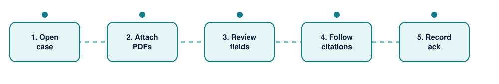

<p align="center"></p>

<p align="center">
  <a href="https://policypilot-demo.onrender.com"><b>Hosted workspace</b></a> &middot;
  <a href="deploy/RENDER_IMAGE_DEMO.md">Deploy</a> &middot;
  <a href="docs/SYNTHETIC_DATA_SPEC.md">Synthetic data</a> &middot;
  <a href="docs/SPECIALIST_NETWORK_PLAN.md">Evaluation</a>
</p>

<p align="center">
  
  
  
  
  
</p>

# PolicyPilot

PolicyPilot is a web application for reviewing **synthetic** health insurance claims. A reviewer opens a case, attaches the policy schedule and claim evidence, and checks dates, identifiers and benefit limits against the original PDF pages. The reviewer records an acknowledgement after checking the evidence.

> **Synthetic data only.** Every document in this repository is fictional and labeled "SYNTHETIC — NOT VALID FOR CLAIM SUBMISSION". There is no pilot partner and no real claim, member or insurer data. Do not upload real personal or medical records to the hosted demo.

## Contents

- [What it does](#what-it-does)
- [How it works](#how-it-works)
- [Try a case](#try-a-case)
- [Architecture](#architecture)
- [Repository layout](#repository-layout)
- [Local development](#local-development)
- [Configuration](#configuration)
- [API overview](#api-overview)
- [Testing and verification](#testing-and-verification)
- [Deployment](#deployment)
- [Research and evaluation](#research-and-evaluation)
- [Archived Ollama prototype](#archived-ollama-prototype)
- [Limitations](#limitations)
- [Documentation index](#documentation-index)

## What it does

- Creates cases and stores uploaded PDFs in private storage, with the original bytes always downloadable.
- Reads six labeled fields from the PDFs: **policy ID, member ID, admission date, discharge date, room limit and sum insured**.
- Reads embedded text with Poppler. Pages flagged as unreadable go through Tesseract OCR and carry a verification warning.
- Attaches an exact source citation (document, page and text offset) to every extracted value.
- Flags conflicting values, for example two different admission dates, and leaves the field unresolved instead of guessing.
- Searches across a case's documents to find the relevant wording or schedule page.
- Records a reviewer acknowledgement against the current review revision.
- Deletes a case, revokes access to it and queues its stored files for cleanup.

The reviewer, not the software, decides how to resolve discrepancies. The model connection is disabled in the current release.

## How it works



1. **Open a case** with a short description.
2. **Attach PDFs** and label each as policy schedule, policy wording, claim form, discharge summary or hospital bill.
3. **Review PDF fields** to run the parser and rules over the case.
4. **Follow citations** back to the page and original text for each field.
5. **Record acknowledgement** once the evidence has been checked.

## Try a case

Open the [hosted workspace](https://policypilot-demo.onrender.com) and sign in with the shared reviewer account. Each person with this account sees the same cases. The free instance may take a while to wake from idle. Use the fictional PDFs in [the sample cases](data/synthetic/exemplars).

For a short interview walkthrough on the PDF review release:

1. Create a case for **SYN-C003**. Enter a short description of the admission-date discrepancy.
2. Attach `04_claim_form.pdf` as **Claim form** and `05_discharge.pdf` as **Discharge summary**. Attach `01_schedule.pdf` as **Policy schedule** and `02_wording.pdf` as **Policy wording** for policy details. The hospital bill includes a page that needs a visual check.
3. Select **Review PDF fields**. Expand **Admission date** and follow both page citations. The two documents disagree, so the field has no resolved value.
4. Search a phrase from the wording or schedule to find the relevant page. Use **Download original** to inspect the PDF, then record your review.

The sample cases are `SYN-C001`, `SYN-C002` and `SYN-C003`. See [data/synthetic/README.md](data/synthetic/README.md) for what each covers.

## Architecture

<table>
<tr><td><b>Web app</b></td><td>FastAPI service in <a href="pilot/">pilot/</a> with a static browser UI and cookie sessions (<code>AUTH_MODE=session</code>)</td></tr>
<tr><td><b>Database</b></td><td>PostgreSQL 16 for cases, sessions, review state and the storage-cleanup queue; SQL migrations in <a href="pilot/migrations">pilot/migrations</a></td></tr>
<tr><td><b>Document storage</b></td><td>Private S3-compatible bucket (Cloudflare R2) or local files for development; see <a href="pilot/STORAGE.md">pilot/STORAGE.md</a></td></tr>
<tr><td><b>PDF review</b></td><td>Poppler (<code>pdfinfo</code>, <code>pdftotext</code>) for embedded text, Tesseract for flagged pages, rule-based field extraction in <code>pilot/field_rules.py</code></td></tr>
<tr><td><b>Inference</b></td><td>Disabled (<code>INFERENCE_BACKEND=disabled</code>, <code>PROCESSING_ENABLED=0</code>); processing cannot enter an unserviced queue</td></tr>
<tr><td><b>Hosting</b></td><td>Docker image on Render (free Singapore web service plus PostgreSQL); image published privately to GHCR</td></tr>
</table>

## Repository layout

| Path | Purpose |
|---|---|
| `pilot/` | Current web application: API, auth, PDF review, storage, migrations, UI assets, Dockerfile and tests |
| `deploy/` | Release script, Render runbooks, Docker Compose/Caddy VPS setup, smoke tests and operator utilities |
| `specialists/` | Research code for the task-specific span-extractor and evidence-ranker networks |
| `training/` | Fine-tuning preparation material |
| `evaluation/` | Frozen evaluation sets, budgets and synthetic previews |
| `data/synthetic/` | Fictional claim bundles, specialist and fine-tune datasets |
| `scripts/` | Development checks (`scripts/dev`) and synthetic data generation (`scripts/synthetic`) |
| `docs/` | Plans, protocols, specifications and runbooks |
| `app/`, `ui/` | Archived local Ollama prototype (see below) |
| `artifacts/` | Recorded verification, release and research outputs |
| `render.yaml`, `render-demo.yaml` | Render blueprints (see [Deployment](#deployment)) |
| `flake.nix`, `shell.nix` | Nix development environments |

## Local development

Requirements: Python 3.12, Node.js 18+, Poppler, Tesseract (English and Hindi data), and Docker for the release gate.

**NixOS** (recommended; the shell provides everything above):

```sh
nix --extra-experimental-features 'nix-command flakes' develop path:.
# or, without flakes:
nix-shell
python scripts/dev/check.py                   # fails if tools, OCR data or tests are missing
python scripts/dev/check.py --require-docker  # also requires Docker daemon access
```

**Other Linux**: install `poppler-utils`, `tesseract-ocr` with the `eng` and `hin` language packs, and then:

```sh
python -m venv .venv && . .venv/bin/activate
pip install -r pilot/requirements.txt
python -m unittest discover -s pilot/tests -v
```

Nix package versions may differ from the pins in `pilot/requirements.txt`, so a local pass does not replace the container tests. See [docs/NIXOS_DEVELOPMENT.md](docs/NIXOS_DEVELOPMENT.md).

**Offline UI preview** (no server, no database):

```sh
python deploy/preview_ui.py
# open artifacts/policypilot-ui-preview.html
```

The preview uses illustrative case records. Generating it needs `prlimit`, `pdfinfo` and `pdftotext` on `PATH`; the generated HTML opens offline without them.

## Configuration

The web application reads these environment variables. Secrets belong in the host's environment settings, never in the repository.

| Variable | Purpose |
|---|---|
| `DATABASE_URL` | PostgreSQL connection string |
| `AUTH_MODE` | `session` for cookie login |
| `APP_ORIGIN` | Public origin; other origins are rejected |
| `PILOT_USER` | Reviewer login name |
| `PILOT_PASSWORD_HASH` | Hash of the reviewer password; generate with `deploy/hash_password.py` |
| `MODEL_OPERATOR` | Role allowed to run storage cleanup |
| `DOCUMENT_STORAGE` | `r2` for the private bucket |
| `R2_ACCOUNT_ID`, `S3_BUCKET`, `AWS_ACCESS_KEY_ID`, `AWS_SECRET_ACCESS_KEY` | Bucket access |
| `INFERENCE_BACKEND` | `disabled` in the current release |
| `PROCESSING_ENABLED` | `0` in the current release |

`deploy/live.env.example` lists the VPS variables. The root `.env.example` belongs to the archived Ollama prototype, not to `pilot/`.

## API overview

Defined in `pilot/api.py` and `pilot/review_routes.py`. All `/api/cases` routes require a session.

| Method | Route | Purpose |
|---|---|---|
| GET | `/healthz` | Liveness and deployment mode (`pdf-field-review`) |
| POST | `/api/auth/login`, `/api/auth/logout` | Start and end a session |
| GET | `/api/auth/me` | Current session |
| POST / GET | `/api/cases` | Create and list cases |
| GET / DELETE | `/api/cases/{id}` | Read or delete a case |
| PUT | `/api/cases/{id}/documents` | Upload a PDF |
| GET | `/api/cases/{id}/documents/{did}` | Download the original PDF |
| POST | `/api/cases/{id}/pdf-review` | Run the field review with citations |
| POST | `/api/cases/{id}/review` | Record the reviewer acknowledgement |
| POST | `/api/cases/{id}/corrections` | Record a reviewer correction |
| GET | `/api/cases/{id}/report` | HTML report |
| GET / POST | `/api/storage/cleanup` | Inspect or process the deletion queue |

## Testing and verification

```sh
python -m unittest discover -s pilot/tests -v       # application tests
python scripts/dev/check.py                         # full local readiness gate
sh deploy/release_web.sh <github-user>              # preview, tests, image build, in-image gate, GHCR publish
python deploy/smoke.py https://policypilot-demo.onrender.com --review-fields --case SYN-C003
```

The smoke test checks authentication, origin rejection, PDF upload, field review, citation offsets, acknowledgement, original-PDF download, case deletion and logout. `SYN-C003` also exercises OCR. An upload-only smoke (without `--review-fields`) does not prove the field-review route is deployed. Recorded results and their limits are in [pilot/VERIFICATION.md](pilot/VERIFICATION.md) and `artifacts/`.

## Deployment

The existing free Render service keeps its database, bucket, login and storage settings. A release only replaces the image reference.

1. Run `sh deploy/release_web.sh <github-user>` and copy the printed `ghcr.io/.../policypilot-api@sha256:...` digest.
2. In the Render service, open **Settings → Image Source → Edit** and replace only the image reference.
3. Keep Docker Command `sh /srv/deploy/render-start.sh web`, set the health check path to `/healthz`, and keep `INFERENCE_BACKEND=disabled` and `PROCESSING_ENABLED=0`.
4. Deploy manually (auto-deploy is off) and run the smoke tests above.

Full steps: [deploy/RENDER_IMAGE_DEMO.md](deploy/RENDER_IMAGE_DEMO.md). `render-demo.yaml` describes the free web and database topology; `render.yaml` is a historical paid web/worker layout. Do not apply either just to update the running service. A single-VPS Docker Compose and Caddy setup is in `deploy/` ([HOSTINGER_RUNBOOK.md](deploy/HOSTINGER_RUNBOOK.md)).

## Research and evaluation

`specialists/` holds two small task-specific networks, an exact-span field extractor and an evidence ranker, built to avoid depending on a language model. On the frozen English test split of the first checkpoint, the span extractor scored 17.7% exact-span F1 against 0% for the rules, and the ranker scored 75% top-1 against 25%. The plan states that field extraction needs substantial improvement before use in the app, and no specialist or model inference is enabled in the deployed service. Evaluation protocol and results: [docs/SPECIALIST_NETWORK_PLAN.md](docs/SPECIALIST_NETWORK_PLAN.md) and [docs/PHASE_0_EVALUATION_PROTOCOL.md](docs/PHASE_0_EVALUATION_PROTOCOL.md). Generated labels share semantic rules, which limits how far the results generalize.

## Archived Ollama prototype

The first version was a local-only RAG decision engine (Ollama, LangChain, FAISS, SQLite, Streamlit) in `app/` and `ui/`. It is kept for reference and is not what the hosted service runs. See [docs/LEGACY_OLLAMA_PROTOTYPE.md](docs/LEGACY_OLLAMA_PROTOTYPE.md).

## Limitations

- Fictional documents only; no domain-expert or insurer validation, and full-corpus OCR checks are outstanding.
- Six fields, English-language PDFs, rule-based extraction. OCR output is flagged for visual verification.
- Single shared reviewer account; the demo has no per-user isolation.
- PostgreSQL, R2, physical deletion and a live deployment are covered by the smoke test, not by the local in-process checks.
- Inference is disabled. Nothing here is an automated claim decision.

## Documentation index

| Topic | Document |
|---|---|
| Render release | [deploy/RENDER_IMAGE_DEMO.md](deploy/RENDER_IMAGE_DEMO.md), [deploy/RENDER_RUNBOOK.md](deploy/RENDER_RUNBOOK.md) |
| Storage design | [pilot/STORAGE.md](pilot/STORAGE.md), [docs/PERSISTENT_STORAGE_PLAN.md](docs/PERSISTENT_STORAGE_PLAN.md) |
| Synthetic data | [docs/SYNTHETIC_DATA_SPEC.md](docs/SYNTHETIC_DATA_SPEC.md), [data/synthetic/README.md](data/synthetic/README.md) |
| Specialist networks | [docs/SPECIALIST_NETWORK_PLAN.md](docs/SPECIALIST_NETWORK_PLAN.md), [specialists/README.md](specialists/README.md) |
| Evaluation | [docs/PHASE_0_EVALUATION_PROTOCOL.md](docs/PHASE_0_EVALUATION_PROTOCOL.md) |
| Production planning | [docs/PRODUCTION_MASTER_PLAN.md](docs/PRODUCTION_MASTER_PLAN.md), [docs/IMPLEMENTATION_PLAN.md](docs/IMPLEMENTATION_PLAN.md) |
| NixOS development | [docs/NIXOS_DEVELOPMENT.md](docs/NIXOS_DEVELOPMENT.md) |
| Legacy prototype | [docs/LEGACY_OLLAMA_PROTOTYPE.md](docs/LEGACY_OLLAMA_PROTOTYPE.md) |
